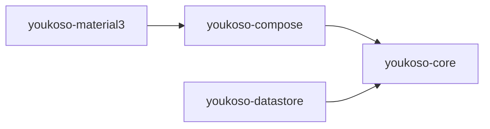

# ADR-0001: Module structure and dependency rules

- **Status:** Accepted
- **Date:** 2026-11-14
- **Deciders:** Anjaly Sajeev (maintainer)

## Context

youkoso has to serve apps that use Material 3, apps with their own design system, and apps
built with Views, while keeping the navigation logic testable without Android. The original
`welcome-android` mixed navigation logic, rendering, persistence and RTL index maths in one
Activity, which made it untestable on the JVM and hard to extend.

## Decision

Four published artifacts with strictly inward-pointing dependencies:

| Module | May depend on | Must not depend on |
|---|---|---|
| `youkoso-core` | Kotlin stdlib (and coroutines for the store port) | Android, AndroidX, Compose |
| `youkoso-compose` | `youkoso-core`, Compose foundation/UI, `androidx.activity` | Material |
| `youkoso-material3` | `youkoso-compose`, Compose Material 3 | `youkoso-datastore` |
| `youkoso-datastore` | `youkoso-core`, Jetpack DataStore | Compose |

- `youkoso-core` is a Kotlin/JVM module (not an Android library), so the compiler enforces that it
  has no Android dependency.
- Shared build configuration lives in `build-logic` convention plugins (`youkoso.jvm.library`,
  `youkoso.android.library`, `youkoso.android.compose`, `youkoso.android.application`), not in
  `buildSrc` or copy-pasted blocks.
- Cross-module APIs that are not meant for consumers will be public but marked with a
  `@RequiresOptIn` annotation (`InternalYoukosoApi`) and excluded from the compatibility promise.
- `minSdk` is 23 for all modules.

## Consequences

- Design-system apps can use `youkoso-compose` without pulling in Material.
- The engine can be unit-tested on the JVM, and could later become Kotlin Multiplatform.
- Four artifacts to version together. A BOM will be published before 1.0 so consumers align them
  in one line.
- Splitting `compose` and `material3` later would have been a breaking change, so the split is
  made now.

## Alternatives considered

- **One artifact:** simplest to consume, but forces Material and Android on everyone and mixes
  layers.
- **Three artifacts (Compose and Material merged):** fewer artifacts, but every consumer gets
  Material.
- **App-style Clean Architecture layers (domain/data/presentation modules with use cases):**
  rejected as ceremony for a UI library; see ADR-0003.
