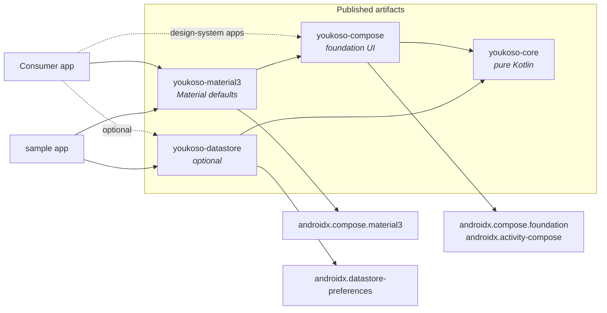
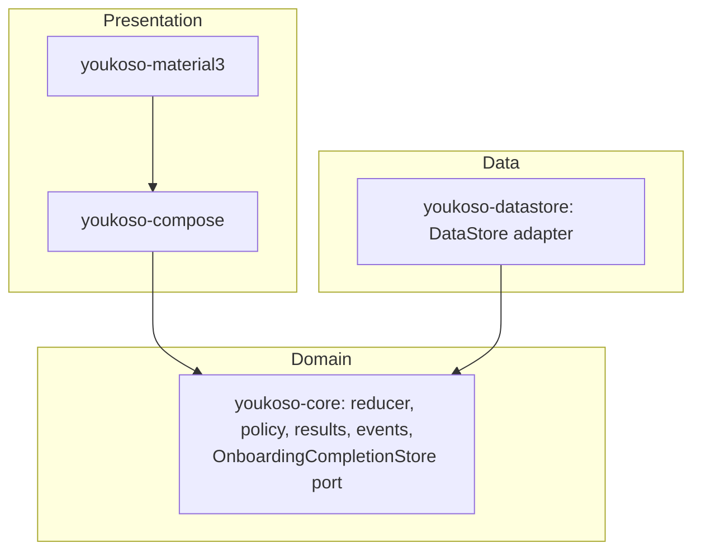
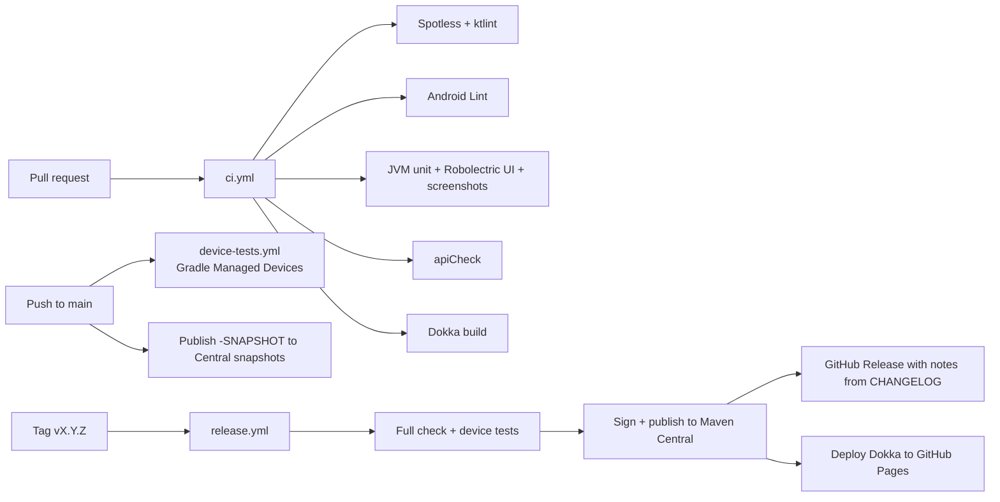
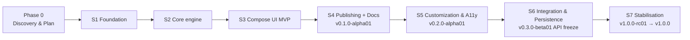
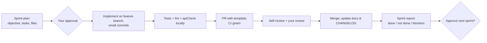

# Technical Proposal: A Modern Android Onboarding Library

> **Status:** Approved on 2026-11-14 (all recommendations in §14 accepted). Sprint 1 is in progress.
> **Name:** **youkoso** (ようこそ, "welcome"). Maven group `io.github.anjalymsajeev`, package `io.github.anjalymsajeev.youkoso`.
> **Prepared:** 2026-11-08 by the maintainer.
> This document records the plan as approved. Later decisions are recorded as ADRs in [`docs/adr/`](adr/), which take precedence where they differ.

---

## 0. How this was produced (transparency)

- The reference repository `stephentuso/welcome-android` was **cloned and its source read directly**: all 32 library Java classes, resources, Gradle files, Travis config, tests, sample app and README.
- **Not reviewed:** the repository's GitHub issues and PRs. GitHub API access to that repo was not enabled in this session. Any statement below about user pain points comes from the code and README, not from issue reports.
- Version numbers for tools (AGP, Kotlin, Compose BOM, etc.) are **not pinned in this document on purpose**. They were looked up from the official Maven repositories and pinned in `gradle/libs.versions.toml` in Sprint 1.

---

## 1. Analysis of `welcome-android`

### 1.1 Snapshot

| Item | Finding |
|---|---|
| Status | Archived. The author's README says "outdated… I won't be maintaining it". Last code change was 2017. |
| Last version | `com.stephentuso:welcome:1.4.1`, distributed via **jCenter/Bintray**. Both services are shut down, so it can't be resolved from a standard build any more. |
| Language | Java, 32 classes, about 3.4k LOC |
| Build | Groovy Gradle, AGP 2.3.1, `compileSdk 25`, `minSdk 9`, `compile` configurations (removed in Gradle 7) |
| Dependencies | Android **Support Library** 25.3.1 (`support-v4`, `appcompat-v7`, `preference-v7`, `support-annotations`). Pre-AndroidX. |
| CI | Travis CI (oraclejdk8, ARM emulator), Codecov, Javadoc pushed to gh-pages |
| License | Apache-2.0 |
| Tests | 33 JVM unit tests (JUnit 4 + Mockito 1.x), 23 instrumented tests in the sample module |

### 1.2 Features (what it got right)

These are the strengths worth keeping, as behaviour, not as code:

1. **Low setup.** You extend `WelcomeActivity`, return a `WelcomeConfiguration` from a builder, and call `WelcomeHelper.show(savedInstanceState)` from your launcher Activity.
2. **Ready-made page types:** `TitlePage`, `BasicPage` (image + header + description), `ParallaxPage`, `FullscreenParallaxPage`, plus `FragmentWelcomePage` for custom fragments.
3. **Background colour interpolation** between pages (`ColorChangingBackgroundView`). This is the library's signature visual effect.
4. **Six bottom-bar layouts** (`STANDARD`, `STANDARD_DONE_IMAGE`, `BUTTON_BAR`, `BUTTON_BAR_SINGLE`, `INDICATOR_ONLY`, `NONE`).
5. **Navigation policy flags:** `canSkip`, `backButtonSkips`, `backButtonNavigatesPages`, `swipeToDismiss` (swiping past the last page completes the flow), `showPrevButton`, `showNextButton`, `animateButtons`.
6. **"Show once" persistence:** completion is stored in SharedPreferences under a key, and changing the key re-shows the screen.
7. **Results:** `RESULT_OK` or `RESULT_CANCELED` plus the key, delivered through `startActivityForResult`.
8. **Scroll callbacks for custom animation:** `WelcomePage.OnChangeListener` (`onWelcomeScreenPageScrolled(index, offset, offsetPixels)`), plus `WelcomeUtils.applyParallaxEffect`.
9. **RTL support**, and **responsive dimensions** through `sw360/430/600/720dp` and `-land` resource qualifiers.
10. **Theming** through theme attributes (`welcomeButtonSkipStyle`, `welcomeIndicatorStyle`, …), a public `public.xml`, and Light/Dark base themes.

### 1.3 Architecture (as implemented)

```mermaid
flowchart TD
    Host[App launcher Activity] -->|WelcomeHelper.show| WA[Your subclass of WelcomeActivity]
    WA -->|abstract configuration()| WC[WelcomeConfiguration + Builder<br/>holds Context, pages, ~20 flags]
    WA --> VP[ViewPager + FragmentPagerAdapter]
    WC --> PL[WelcomePageList]
    PL --> WP["WelcomePage&lt;T&gt; subclasses<br/>(also cache their Fragment instance)"]
    VP -->|OnPageChangeListener| IL[WelcomeItemList<br/>broadcasts scroll events]
    IL --> BTN[Skip/Next/Prev/Done ViewWrappers]
    IL --> IND[SimpleViewPagerIndicator]
    IL --> BG[ColorChangingBackgroundView]
    IL --> HID[WelcomeViewHider - swipe to dismiss]
    IL --> WP
    WA -->|complete| SP[WelcomeSharedPreferencesHelper]
```

It is an **inheritance-centred, single-Activity design**. Navigation logic, rendering, persistence and RTL index maths are all mixed together inside `WelcomeActivity` and the view wrappers. Nothing can be tested without Android.

### 1.4 Deprecated or removed APIs and practices

| Used in welcome-android | Status today | Modern replacement |
|---|---|---|
| Support Library (`android.support.*`) | Ended at 28.0.0; superseded by AndroidX | AndroidX |
| `ViewPager` + `FragmentPagerAdapter` | `FragmentPagerAdapter` deprecated | Compose `HorizontalPager` (or `ViewPager2`) |
| `onBackPressed()` override | Deprecated (API 33+); incompatible with predictive back | `OnBackPressedDispatcher` / Compose `BackHandler` / `PredictiveBackHandler` |
| `startActivityForResult` / `onActivityResult` | Deprecated in AndroidX Activity/Fragment | `ActivityResultContract` |
| `overridePendingTransition` | Deprecated (API 34) | `overrideActivityTransition` / in-Compose transitions |
| `SharedPreferences.commit()` on the main thread | Discouraged (blocking I/O) | Jetpack DataStore |
| Typefaces loaded from **asset paths** (`skipButtonTypefacePath`, …) | Obsolete | Theme typography, `FontFamily`, downloadable fonts |
| `preference-v7` dependency (for `WelcomePreferenceFragment`) | Heavy, unrelated dependency | Drop it |
| jCenter / Bintray publishing | Services shut down | Maven Central (Central Portal) |
| Travis CI with an ARM emulator | Obsolete | GitHub Actions + Gradle Managed Devices |
| `Build.VERSION.SDK_INT < 11` checks | Dead code | Remove (minSdk ≥ 23) |
| Manual status-bar handling (`values-v19` styles) | Edge-to-edge is enforced at targetSdk 35+ | `enableEdgeToEdge()` + window insets |

### 1.5 Design defects and limitations

These are the reasons to redesign rather than port. Each one maps to a requirement in §3.

1. **State is thrown away on purpose.** `WelcomeActivity.onCreate` calls `super.onCreate(null)` with the comment *"Passing null for savedInstanceState fixes issue with fragments… TODO: Look into this more"*. This works around a stale-fragment bug by discarding all saved state: the current page and fragment state are lost on rotation and on process death.
2. **Page models cache Fragment instances** (`WelcomePage.fragment`). Fragments are recreated by the framework, so the cached references go stale. That is the root cause of defect 1.
3. **`WelcomeConfiguration` holds a `Context`** inside its Builder for its whole lifetime, which risks leaks and blocks pure unit testing.
4. **The persistence key comes from reflection.** `WelcomeUtils.getKey` reflectively calls a static `welcomeKey()` on the Activity class. This needs a ProGuard keep rule, and it fails silently if the rule is missing.
5. **RTL is done by reversing the page list** and hand-mirroring every index (`isRtl ? -1 : 1` appears throughout). Modern pagers respect `LayoutDirection` natively, so this whole class of bugs goes away.
6. **Configuration is "boolean soup."** About 20 independent flags allow contradictory states, for example `canSkip=false` with `backButtonSkips=true`. The six bottom layouts are a closed enum of XML files, so customising beyond them means forking the layouts.
7. **Inheritance is required.** You must subclass `WelcomeActivity`. The screen can't be embedded in an existing screen, Fragment, Compose navigation graph or bottom sheet.
8. **Parallax is tied to specific page classes** instead of being a general capability any page can use.
9. **Accessibility is minimal.** There are no content descriptions for page position, no announcements of page changes, no reduced-motion handling, and image-only "done" buttons.
10. **There is no analytics or event hook** beyond the final result code.
11. **The test seams are weak.** Logic lives in Activity and View classes, so most behaviour can only be checked with instrumented tests.

### 1.6 Opportunities

- **Compose-first** rendering: slot APIs replace the bottom-layout enum, and page offset is exposed to every page, which replaces the parallax page classes.
- A **pure-Kotlin navigation state machine**: deterministic, unit-tested on the JVM, and free of illegal states.
- **Proper state restoration** through `rememberSaveable`, with process-death tests.
- **Persistence and launching are optional**, so apps that use their own routing aren't forced into an Activity.
- First-class **accessibility, predictive back, edge-to-edge and large-screen** support.
- **API stability tooling** (explicit API mode, binary-compatibility validation) that the original never had.

---

## 2. Library vision

> **A small, Compose-native onboarding library that gives you a polished, accessible onboarding flow in about ten lines, and lets you replace every visual piece without fighting the library.**

Guiding principles:

1. **Behaviour over widgets.** The hard and reusable part is the navigation and policy logic: skip rules, back behaviour, completion, restoration and accessibility. Visuals are defaults you can replace.
2. **Embeddable, not imposing.** It is a composable first. Activity hosting and "show once" persistence are opt-in helpers, never requirements.
3. **A small, stable API surface.** It is easier to add API later than to remove it. Everything public is deliberate, documented and checked for binary compatibility.
4. **No surprise dependencies.** Each artifact pulls in only what its job needs.

**Non-goals (v1):** a visual editor, remote or server-driven configuration, a View/XML rendering engine (see §5.3), video pages, Kotlin Multiplatform (kept possible, not promised; see §5.4), and analytics SDK integrations (we expose events; apps wire them to their own SDKs).

---

## 3. Requirements

### 3.1 Functional requirements

Priority uses **MoSCoW** (M = Must, S = Should, C = Could, W = Won't for v1.0).

| ID | Requirement | Priority | Origin |
|---|---|---|---|
| FR-01 | Display an ordered list of N ≥ 1 pages with horizontal swipe navigation | M | Orig. |
| FR-02 | Provide a standard page (title, description, image/illustration slot) | M | Orig. |
| FR-03 | Support fully custom page content | M | Orig. |
| FR-04 | Next, Previous, Skip and Finish actions, with visibility driven by state and policy | M | Orig. |
| FR-05 | Page indicator (dots by default, replaceable) | M | Orig. |
| FR-06 | Navigation policy: skip allowed/disallowed, per-page "can't proceed until…" gating, back-press behaviour | M | Orig. + new |
| FR-07 | Result callback: Completed, Skipped (with page), Dismissed | M | Orig. |
| FR-08 | Programmatic control: go to page, next, previous, finish | M | New |
| FR-09 | Preserve the current page across configuration change **and process death** | M | Fixes defect 1 |
| FR-10 | RTL support through layout direction | M | Orig. |
| FR-11 | Light/dark theming that follows the app theme, with overridable colours, typography and shapes | M | Orig. |
| FR-12 | Accessibility: page-position semantics, page-change announcements, touch targets ≥ 48dp, font scaling to 200%, reduced motion | M | New |
| FR-13 | Edge-to-edge and window-inset handling | M | New (platform) |
| FR-14 | Predictive back support | S | New (platform) |
| FR-15 | Per-page background colour with interpolation during swipe | S | Orig. signature |
| FR-16 | Page scroll offset exposed to page content for custom transitions and parallax | S | Orig. (generalised) |
| FR-17 | Built-in page transition presets (slide, fade, scale/depth) | S | Orig. + new |
| FR-18 | Lifecycle and analytics events (page viewed, action taken, result) | S | New |
| FR-19 | Optional "show once" completion store with versioned keys | S | Orig. |
| FR-20 | Launching from View/XML apps through `ActivityResultContract` | S | Orig. use case |
| FR-21 | Responsive layout: side-by-side image/text on wide windows, sensible landscape behaviour | S | Orig. |
| FR-22 | Swipe past the last page to finish | C | Orig. |
| FR-23 | Auto-advance (timed pages) | C | New |
| FR-24 | Lottie or animated vector illustrations | C (via custom slot; no dependency) | New |
| FR-25 | A native View/XML renderer | W | See §5.3 |

### 3.2 Non-functional requirements

| ID | Category | Requirement |
|---|---|---|
| NFR-01 | Compatibility | `minSdk 23` (proposed; see §14.2). `compileSdk`/`targetSdk` = latest stable at each release. |
| NFR-02 | API stability | Kotlin **explicit API mode**; **binary-compatibility validation** in CI; SemVer; deprecation cycle of at least one minor release before removal after 1.0. |
| NFR-03 | Dependencies | `core` has **zero Android dependencies**. UI artifacts depend only on AndroidX/Compose. No third-party runtime dependencies. |
| NFR-04 | Size | Each artifact is small and R8-friendly. Ship consumer ProGuard rules only if needed (goal: none, because there is no reflection). |
| NFR-05 | Performance | No recomposition of page content per scroll frame. Offset reads are deferred to the layout/draw phase. Ship a baseline profile with the UI artifact. |
| NFR-06 | Testability | Core logic fully covered by JVM tests (≥ 90% line coverage on `core`). UI behaviour covered by Compose UI tests. |
| NFR-07 | Accessibility | Passes the Compose accessibility checks in tests (`enableAccessibilityChecks()`, where available in the pinned ui-test version) plus a manual TalkBack checklist per release. |
| NFR-08 | Documentation | Every public declaration has KDoc. Dokka site published. README quick start works copy-paste. |
| NFR-09 | Security | No secrets in the repo; signing keys only in GitHub encrypted secrets; reproducible release from a tag. |
| NFR-10 | Maintainability | Convention plugins for shared build logic; formatting and lint gates in CI; one-command local verification (`./gradlew check`). |
| NFR-11 | Localisation | No hard-coded user-facing strings. Default labels ("Skip", "Next", "Done") come from resources that apps can override or translate. |

---

## 4. Technology stack

| Concern | Choice | Justification / trade-off |
|---|---|---|
| Language | Kotlin (K2 compiler), explicit API mode | Standard for Android. Explicit API mode makes every public declaration deliberate. |
| Build | Gradle Kotlin DSL, version catalog, **convention plugins in `build-logic/`** | Removes copy-pasted Android/Kotlin config across 4+ modules. Preferred over `buildSrc` because it invalidates less of the build cache. |
| UI | **Jetpack Compose** (foundation + Material 3, split; see §5.2) | Current Android UI default; slot APIs fit this problem well; `HorizontalPager` gives native RTL, paging and saveable state. |
| State | Compose snapshot state + `rememberSaveable`, backed by a pure-Kotlin reducer in `core` | Follows the platform's own state-holder pattern (`PagerState`, `LazyListState`). See §5.1 for why there is no ViewModel. |
| Async | Coroutines (`suspend` navigation such as `animateToPage`). **Flow only in the persistence API.** | Use Flow where data really streams (stored completion flags). UI events are plain callbacks, which are simpler for consumers than collecting a Flow. |
| Persistence (optional) | Jetpack **DataStore (Preferences)** | Async, transactional; replaces main-thread `SharedPreferences.commit()`. |
| Back handling | `androidx.activity` `BackHandler` / `PredictiveBackHandler` | Correct on API 33+ with predictive back. |
| Unit tests | JUnit 4 + `kotlin.test` assertions; **fakes over mocks** | Core is pure and dependency-inverted, so hand-written fakes are clearer. **MockK is probably unnecessary**; I suggest adding it only if a real need appears. |
| Flow tests | **Turbine**, in the persistence module only | It's the right tool where a Flow is exposed, and isn't needed elsewhere. |
| UI tests | Compose UI test on **Robolectric** (JVM, fast, runs every PR) + a small **instrumented** suite on Gradle Managed Devices | Fast feedback on every PR plus real-device confidence. |
| Screenshot tests | **Roborazzi** (Robolectric-based); evaluated in Sprint 3 against Google's Compose Preview Screenshot Testing | Catches visual regressions in light/dark, RTL, font scale and widths. Choice confirmed after a short spike. |
| Static analysis | Android Lint (`warningsAsErrors` for library modules), **Spotless + ktlint**, Slack **compose-lints** rules (build-time only) | Formatting and Compose-specific API checks, such as modifier parameter order and correct `remember` usage. |
| API compatibility | `kotlinx-binary-compatibility-validator` (BCV). Kotlin's built-in ABI validation was still experimental in Sprint 1 and didn't support AGP 9's built-in Kotlin; see [ADR-0004](adr/0004-abi-validation.md) | Fails CI on accidental public API breaks. |
| Docs | **Dokka 2** (HTML) on GitHub Pages + Markdown guides in `docs/` | KDoc is the API reference; guides explain concepts. |
| Publishing | **Maven Central (Sonatype Central Portal)** via the `com.vanniktech.maven.publish` plugin | Central is the default repository for all Android builds. The plugin handles Central Portal upload, sources/javadoc jars, POM and in-memory signing. |
| CI/CD | GitHub Actions; Dependabot or Renovate for dependency updates | Native to GitHub, free for public repos. |

**Considered and rejected:** Hilt/Koin (a library must not impose a DI framework, so we use constructor injection), RxJava, `kotlinx.collections.immutable` (strong skipping mode in the Compose compiler removes most of the stability motivation, and it would be a runtime dependency forced on consumers), Accompanist (its pager has been folded into Compose foundation).

---

## 5. Architecture proposal

### 5.1 Is "Clean Architecture + MVVM" right for a UI library? (challenge)

You asked for Clean Architecture and MVVM. I recommend applying their **principles** (dependency rule, separation of concerns, dependency inversion) but **not** their usual app-level **structure**:

- **No use-case classes or repositories per action.** `NextPageUseCase`, `SkipUseCase` and so on would be ceremony around what are pure functions of `(state, action) → state`. That would hurt readability, which reviewers of an open-source library notice.
- **No ViewModel in the public API.** A library composable that creates its own ViewModel hides state, ties itself to a `ViewModelStoreOwner` and fights hosting in sheets, dialogs or nav destinations. The Compose convention, used by `PagerState`, `ScrollState` and `DrawerState`, is a **hoisted, saveable plain state holder**. Apps that want a ViewModel can put their *own* data in one and pass it in.
- **What we keep from Clean Architecture:**
  - **Domain layer = `youkoso-core`**: pure Kotlin, no Android. It holds the navigation state machine, policies, results and events, plus the persistence **port** (an interface).
  - **Presentation layer = Compose modules**: they depend on core and render state.
  - **Data layer = `youkoso-datastore`**: an **adapter** that implements the core port. It is optional.
  - Dependencies point inward only. Core knows nothing about Compose or DataStore.
- **Presentation pattern:** **unidirectional data flow (UDF)**. The UI sends `OnboardingAction`s to the state holder, the internal reducer produces new state and side effects (`OnboardingEvent`, `OnboardingResult`), and the UI renders. This is MVI-shaped without a framework.

### 5.2 Module structure

```
youkoso/
├── build-logic/                 # Convention plugins (android-library, kotlin-library, publishing, compose)
├── youkoso-core/                 # Pure Kotlin/JVM. Navigation state machine, policies, results, events, store port
├── youkoso-compose/              # Compose foundation layer: BasicOnboarding, OnboardingState, pager, page scope,
│                                #   transitions, background interpolation, a11y semantics, back handling, indicators
├── youkoso-material3/            # Material 3 defaults: Onboarding(), standard page, buttons, theming defaults
├── youkoso-datastore/            # Optional: DataStore-backed OnboardingCompletionStore
├── sample/                      # Showcase app (Compose + one View/XML-launch example)
├── docs/                        # Guides, ADRs (architecture decision records), release process
└── gradle/libs.versions.toml
```

**Why split `compose` (foundation) from `material3`?** Many production apps use their own design system, not Material. If the only artifact depended on `material3`, those apps would pull in Material and have to override every default. The split follows Compose's own layering (`BasicTextField` vs `TextField`). **Cost:** one extra artifact and a little API duplication. If you'd prefer fewer artifacts, merging them is a reasonable choice, but it must be decided **before 1.0** because splitting later is a breaking change.

**Why not put the `ActivityResultContract` in its own module?** It only needs `androidx.activity`, which `youkoso-compose` already depends on. It lives in `youkoso-compose` under an `.activity` package, so there's one less artifact.

### 5.3 Compose vs Views (decision)

| Option | Pros | Cons |
|---|---|---|
| A. **Compose-only rendering + Activity launch helper** (recommended) | One renderer to maintain; modern; View apps can still launch it via `ActivityResultContract` or embed it via `ComposeView` | View apps take on a Compose runtime dependency |
| B. Compose + a parallel View/XML renderer | Native for legacy XML apps | Doubles UI code, tests and theming surface. Every feature is built twice. Not sustainable for a solo maintainer. |
| C. Views-only (`ViewPager2`) | No Compose dependency | Builds on the legacy UI stack for a new 2026 library; weak portfolio signal; slot-style customisation is awkward |

**Recommendation: A.** The renderer-agnostic `youkoso-core` leaves room for option B later if real demand appears. That's the main architectural payoff of keeping core separate.

### 5.4 Kotlin Multiplatform?

`youkoso-core` will be written so it *could* become a KMP module (no JVM-only APIs). Making the UI Compose Multiplatform is **out of scope for v1**: it multiplies the CI and test matrix, and Android-specific features (predictive back, insets, Activity results) are central here. It's worth revisiting after 1.0.

### 5.5 Diagrams

**Module dependency graph**



**Runtime data flow (UDF)**

```mermaid
flowchart TD
    U[User: swipe / tap Next / Skip / Back] --> A[OnboardingAction]
    P[App code: state.next(), goTo()] --> A
    A --> R{{core reducer<br/>pure: state + action + policy}}
    R --> S[New NavigationState<br/>current page, flags]
    R --> E[Side effects:<br/>OnboardingEvent, OnboardingResult]
    S --> ST[OnboardingState<br/>Compose state holder, saveable]
    ST --> UI[Pager, controls, indicator, background]
    E --> CB[onEvent / onResult callbacks]
    CB -.optional.-> STORE[OnboardingCompletionStore.markCompleted]
    UI --> U
```

**Layering**



### 5.6 Internal APIs shared across modules

Kotlin `internal` doesn't cross module boundaries, but `youkoso-compose` needs the core reducer. **Approach:** the reducer is public but annotated with a library-defined `@RequiresOptIn(level = ERROR) annotation class InternalYoukosoApi`, and it's excluded from the compatibility promise. This is the same pattern kotlinx and Compose use.

---

## 6. Public API design (sketch, not final)

These are illustrations to review the *shape*. Names and signatures will be finalised in Sprints 2–3, and API review happens again before beta.

### 6.1 Simplest usage (Material 3)

```kotlin
@Composable
fun AppOnboarding(onDone: () -> Unit) {
    Onboarding(
        pages = listOf(
            onboardingPage(key = "welcome") {
                StandardPage(
                    title = stringResource(R.string.welcome_title),
                    description = stringResource(R.string.welcome_body),
                    image = painterResource(R.drawable.illustration_welcome),
                )
            },
            onboardingPage(key = "sync") { /* any composable */ },
        ),
        onResult = { onDone() },
    )
}
```

### 6.2 Core types (`youkoso-core`)

```kotlin
public class OnboardingPolicy(
    public val skip: SkipPolicy = SkipPolicy.Allowed,
    public val back: BackBehavior = BackBehavior.PreviousPageThenDismiss,
    public val finishOnSwipePastLast: Boolean = false,
)

public sealed interface SkipPolicy {
    public data object Allowed : SkipPolicy
    public data object Disallowed : SkipPolicy
}

public enum class BackBehavior { PreviousPageThenDismiss, Dismiss, Skip, Ignore }

public sealed interface OnboardingResult {
    public val lastPageKey: String
    public class Completed(override val lastPageKey: String) : OnboardingResult
    public class Skipped(override val lastPageKey: String) : OnboardingResult
    public class Dismissed(override val lastPageKey: String) : OnboardingResult
}

public sealed interface OnboardingEvent {
    public class PageViewed(public val key: String, public val index: Int) : OnboardingEvent
    public class ActionPerformed(public val action: OnboardingAction, public val fromKey: String) : OnboardingEvent
}

/** Port for "show once" behaviour. Implemented by youkoso-datastore or by the app. */
public interface OnboardingCompletionStore {
    public fun isCompleted(key: String): Flow<Boolean>
    public suspend fun markCompleted(key: String)
    public suspend fun reset(key: String)
}
```

The illegal states of the original disappear: `SkipPolicy.Disallowed` with `BackBehavior.Skip` is rejected when the policy is constructed (`require`), and that rejection is unit-tested.

### 6.3 Compose foundation (`youkoso-compose`)

```kotlin
@Stable
public class OnboardingState internal constructor(/* wraps PagerState; not exposed */) {
    public val currentPage: Int
    public val pageCount: Int
    public val isFirstPage: Boolean
    public val isLastPage: Boolean
    public suspend fun next()
    public suspend fun previous()
    public suspend fun animateToPage(index: Int)
}

@Composable
public fun rememberOnboardingState(initialPage: Int = 0): OnboardingState // rememberSaveable-backed

public interface OnboardingPage {
    public val key: String                 // stable: used for saved state, events, results
    public val canProceed: Boolean         // per-page gating (e.g., "accept terms")
    @Composable public fun OnboardingPageScope.Content()
}

public fun onboardingPage(
    key: String,
    canProceed: Boolean = true,
    content: @Composable OnboardingPageScope.() -> Unit,
): OnboardingPage

@Stable
public interface OnboardingPageScope {
    public val pageIndex: Int
    /** -1..1 offset of this page from center; read inside graphicsLayer {} to avoid recomposition. */
    public fun pageOffset(): Float
}

@Composable
public fun BasicOnboarding(
    pages: List<OnboardingPage>,
    onResult: (OnboardingResult) -> Unit,
    controls: @Composable OnboardingControlsScope.() -> Unit,   // no default: no design opinions here
    modifier: Modifier = Modifier,
    state: OnboardingState = rememberOnboardingState(),
    policy: OnboardingPolicy = OnboardingPolicy(),
    transition: PageTransition = PageTransition.Slide,
    background: OnboardingBackground = OnboardingBackground.None,
    onEvent: (OnboardingEvent) -> Unit = {},
)
```

### 6.4 Material 3 (`youkoso-material3`)

`Onboarding(...)` takes the same parameters as `BasicOnboarding`, but `controls` and `indicator` default to Material components, and colours come from `MaterialTheme` through `OnboardingDefaults.colors()`. It also provides `OnboardingPageScope.StandardPage(...)`, which uses an adaptive layout: image above text in compact width, side by side when the window is expanded.

### 6.5 View/XML apps

```kotlin
// 1. A regular ComponentActivity in the app hosts the composable (no library base class required):
class IntroActivity : ComponentActivity() {
    override fun onCreate(savedInstanceState: Bundle?) {
        enableEdgeToEdge(); super.onCreate(savedInstanceState)
        setContent { AppTheme { Onboarding(pages, onResult = { setOnboardingResult(it); finish() }) } }
    }
}
// 2. Any Activity/Fragment, View-based or not, launches it:
val launcher = registerForActivityResult(OnboardingContract(IntroActivity::class.java)) { result -> … }
```

This uses composition rather than requiring a subclass. A convenience abstract `OnboardingActivity` will be added **only** if the sample shows the boilerplate is a real burden. That decision is made in Sprint 6.

### 6.6 API-stability rules (what I'll enforce)

- **No public `data class`.** Its `copy`/`componentN` make adding a field binary-breaking. Use regular classes with explicit `equals`/`hashCode`/`toString`.
- **Adding a parameter to a public composable is binary-breaking.** After 1.0, new parameters go into new overloads, and the old one is kept with `@Deprecated(level = HIDDEN)`.
- **Sealed hierarchies that consumers `when` over** (`OnboardingResult`) are frozen at 1.0, which is documented. Extensible concepts (`PageTransition`, `OnboardingBackground`) are interfaces with factory presets, so new presets aren't breaking.
- Don't expose `PagerState` or any `@Experimental*` foundation type, so we're isolated from upstream churn.

---

## 7. Testing strategy

| Layer | What | Tool | Where it runs |
|---|---|---|---|
| Core logic | Reducer transitions for every action × position × policy; policy validation; RTL-agnostic indexing; event emission | JUnit 4, `kotlin.test`, table-driven / parameterised tests | JVM, every PR |
| Core properties | Invariants: `0 ≤ current < count`; `Finish` only emitted once; Skip never emitted under `Disallowed` | Simple generated-input loops (no property-testing dependency unless justified) | JVM, every PR |
| Persistence | Store semantics, key versioning, Flow emissions | Turbine, DataStore with a temp file | JVM, every PR |
| Compose behaviour | Button visibility per page, swipe and click navigation, `canProceed` gating, back handling, result callbacks, `rememberSaveable` restoration via `StateRestorationTester` | Compose UI test + Robolectric | JVM, every PR |
| Accessibility | Semantics (page "2 of 4"), touch-target size, content descriptions, accessibility checks | Compose UI test | JVM, every PR |
| Visual regression | Light/dark × LTR/RTL × font scale 1.0/2.0 × compact/expanded | Roborazzi (pending spike) | JVM, every PR |
| Device integration | Process death (`ActivityScenario.recreate` + "Don't keep activities" scenario), predictive back, edge-to-edge insets, Activity result contract | AndroidX Test on Gradle Managed Devices (API 23 + latest) | CI on `main` and nightly; locally before releases |
| API | Public API dump diff | Binary-compatibility validation | Every PR |
| Sample | Smoke test that the sample launches and completes the flow | Instrumented | With device suite |

**Definition of a tested feature:** it has a core test (if it has logic), a UI behaviour test, and, if it's visual, a screenshot test, plus KDoc and a guide entry.

---

## 8. CI/CD and publishing strategy

### 8.1 Workflows



Also included: `gradle/actions/wrapper-validation`, Gradle configuration cache and build cache, concurrency groups to cancel superseded runs, Dependabot/Renovate for Gradle and Actions, and pinned action versions.

### 8.2 Publishing

| Topic | Plan |
|---|---|
| Repository | **Maven Central via the Sonatype Central Portal.** The legacy OSSRH flow is retired, so new projects use the Portal. |
| Coordinates | `io.github.anjalymsajeev:youkoso-core`, `…:youkoso-compose`, `…:youkoso-material3`, `…:youkoso-datastore`. The `io.github.anjalymsajeev` namespace is verified through GitHub, with no domain needed. |
| BOM | `youkoso-bom` added in the release sprint if there are 3 or more artifacts, so consumers align versions in one line. Low cost, real benefit. |
| POM | Name, description, URL, Apache-2.0 license, developer (you), SCM. Defined once in a convention plugin. |
| Artifacts | AAR/JAR, sources JAR, Javadoc JAR (Dokka-generated), Gradle module metadata. |
| Signing | GPG key used only for this project. Private key, passphrase and Central Portal user token stored as **GitHub encrypted secrets** and passed to Gradle as environment variables (`ORG_GRADLE_PROJECT_signingInMemoryKey`, …). **Never** in `gradle.properties` in the repo. |
| Release trigger | Only from a signed/annotated tag on `main`, by the `release.yml` workflow, gated by a protected GitHub **environment** that requires your manual approval. |
| GitHub Packages | **Not recommended** as the primary channel: consumers must authenticate even for public packages, which is real friction for a library. JitPack is also not recommended (unsigned, builds on demand, less reproducible). |
| Pre-releases | `0.x.y-alpha0N` / `-beta0N` / `-rc0N` published to Central and clearly labelled. Only `1.0.0` is described as stable. |

### 8.3 Versioning

- SemVer. Before 1.0: minor bumps may break, and that is documented in the CHANGELOG under "Breaking".
- From `beta01` onward, the API is frozen except for review fixes.
- The CHANGELOG follows *Keep a Changelog*. Release notes are generated from it, not invented.

---

## 9. Sprint roadmap

I've changed your proposed roadmap in four ways:

1. **Quality gates move into Sprint 1.** Explicit API mode, API validation, lint and CI start on day one; adding them later means a painful clean-up.
2. **Publishing risk is brought forward.** Namespace verification, signing and a first `alpha` happen in Sprint 4, not at the end. Publishing problems should show up while the stakes are low.
3. **The sample app grows every sprint** instead of being built in Sprint 5. It's the integration test for API ergonomics.
4. **Sprint 7 is a dedicated stabilisation sprint** before 1.0.

Sprints are **scope-boxed**, not time-boxed. You review and approve at the end of each one. Indicative effort uses story points (SP, Fibonacci) as a relative measure only.



**Workflow inside every sprint**



---

### Phase 0: Discovery and Architecture (this document)

- **Deliverable:** this proposal. **Exit:** your approval, plus decisions on the open questions in §14.

---

### Sprint 1: Project Foundation (≈ 8 SP)

| Item | Detail |
|---|---|
| Objective | A buildable, empty multi-module repo with all quality gates enforced. |
| Requirements | NFR-02, 03, 08, 09, 10 |
| Tasks | Init repo and Gradle wrapper; `libs.versions.toml` (verified latest stable versions); `build-logic` convention plugins (`youkoso.jvm.library`, `youkoso.android.library`, `youkoso.android.compose`, `youkoso.android.application`; the publishing plugin moved to Sprint 4, where it's first needed); create 4 library modules + sample with placeholder packages; explicit API mode; ABI validation; Spotless/ktlint; Lint config; Dokka wiring; `ci.yml`; README skeleton, LICENSE, CONTRIBUTING, CODE_OF_CONDUCT, SECURITY, issue/PR templates, ADRs in `docs/adr/` capturing the decisions in this document |
| Architecture decisions | ADR-0001 (modules), ADR-0002 (Compose-first), ADR-0003 (no ViewModel in API) |
| Testing | A trivial test per module proves the test tasks are wired; CI runs green |
| Acceptance | `./gradlew check` passes locally and in CI; `apiCheck` fails if an unintended public declaration is added (shown in the PR description) |
| Deliverables | Repo on GitHub, green CI badge, docs skeleton |
| Risks | Toolchain version mismatches (AGP/Kotlin/Compose compiler). Mitigation: pin from official compatibility tables. |
| Release | None (internal) |

### Sprint 2: Core Onboarding Engine (≈ 13 SP)

| Item | Detail |
|---|---|
| Objective | A pure-Kotlin navigation engine that is fully specified by tests. |
| Requirements | FR-04, 06, 07, 08, 18 (model), 19 (port) |
| Tasks | `OnboardingPolicy`, `SkipPolicy`, `BackBehavior` with validation; `OnboardingAction`; `NavigationState`; reducer producing state + effects; `OnboardingResult`, `OnboardingEvent`; `OnboardingCompletionStore` interface; `InternalYoukosoApi` opt-in; KDoc throughout |
| Technical design | Reducer = `fun reduce(state, action, policy): Transition`. No coroutines in core except the store port. Page metadata in core is `(key, canProceed)` only, with no UI types. |
| Testing | Table-driven tests for every action × position (first/middle/last/single page) × policy; invariants; ≥ 90% line coverage reported (Kover) |
| Acceptance | All FR-06 policy combinations either behave as specified or are rejected at construction; tests document each rule |
| Risks | Over-modelling. Mitigation: only states the UI actually needs; review the API dump in the PR. |
| Release | None (internal) |

### Sprint 3: Compose UI MVP (≈ 21 SP)

| Item | Detail |
|---|---|
| Objective | A usable onboarding screen in Compose: pager, controls, indicator, standard page. |
| Requirements | FR-01–05, 09, 10, 11 (basic), 12 (baseline), 13 |
| Tasks | `OnboardingState` + `rememberOnboardingState` (saveable); `BasicOnboarding` with `HorizontalPager`; page scope with deferred `pageOffset()`; default `DotIndicator` (Canvas, no Material); back handling via `BackHandler`; insets; Material 3 `Onboarding` + `StandardPage` + default controls; string resources; semantics ("Page 2 of 4"); sample screens; Roborazzi vs Preview-Screenshot spike and decision |
| Testing | Robolectric Compose tests for navigation, visibility, gating, result callbacks, rotation restoration; screenshot baselines for light/dark/RTL |
| Acceptance | The sample shows a 4-page flow; rotation keeps the page; TalkBack announces the position; RTL swipes in the correct direction without index hacks |
| Risks | Pager API experimental status. Mitigation: wrap it, never expose it, opt in internally only. |
| Release | Internal milestone `0.1.0-SNAPSHOT` |

### Sprint 4: Publishing Pipeline and Documentation v1 (≈ 13 SP)

| Item | Detail |
|---|---|
| Objective | Prove the end-to-end release path and ship a first public **alpha**. |
| Requirements | NFR-08, 09; §8 |
| Tasks | Central Portal account + `io.github.anjalymsajeev` namespace verification (done by **you**; I can't do this); GPG key + GitHub secrets (done by **you**); finish the `youkoso.publish` convention plugin (POM, signing, sources/javadoc); `release.yml` with a protected environment; snapshot publishing on `main`; Dokka on GitHub Pages; README quick start, installation and basic usage guides; CHANGELOG; release-process doc |
| Testing | `publishToMavenLocal` + a clean external test project consuming the local artifacts; verify POM/signature contents |
| Acceptance | `0.1.0-alpha01` resolves from Maven Central in a fresh project; docs site is live; no secrets in the repo (verified by a secret-scanning check) |
| Risks | Namespace verification and signing problems. Mitigation: do them first in the sprint; dry-run with snapshots. |
| Release | **v0.1.0-alpha01** (pre-release, labelled unstable) |

### Sprint 5: Customisation, Motion and Accessibility (≈ 21 SP)

| Item | Detail |
|---|---|
| Objective | Bring back the original's visual strengths in a general form, and make it accessible. |
| Requirements | FR-11 (full), 12 (full), 14, 15, 16, 17, 21 |
| Tasks | `PageTransition` presets (slide, fade, depth) + custom; `OnboardingBackground` with per-page colour interpolation; parallax helper `Modifier.pageParallax(scope, factor)`; theming defaults (`OnboardingDefaults.colors/typography`); reduced-motion support (respect the system animator duration scale); predictive back on the last/first page; adaptive `StandardPage` for expanded widths; font-scale 200% layout fixes; performance check (no per-frame recomposition, verified with composition-count tests) |
| Testing | Screenshot matrix; a11y checks; recomposition-count tests; manual TalkBack + Switch Access checklist |
| Acceptance | Each FR has a test and a guide entry; the sample has a "customisation gallery" |
| Risks | API sprawl. Mitigation: presets as interfaces + factories; review the API dump before merge. |
| Release | **v0.2.0-alpha01** |

### Sprint 6: Integration and Persistence (≈ 13 SP)

| Item | Detail |
|---|---|
| Objective | Make it easy to adopt in real apps, including View-based ones. |
| Requirements | FR-18, 19, 20, 22 |
| Tasks | `youkoso-datastore` (`DataStoreOnboardingStore`, versioned keys such as `"intro"` + version); `OnboardingContract` + `setOnboardingResult` helper; the decision on an `OnboardingActivity` convenience; event callbacks finalised; swipe-past-last to finish; sample: XML Activity launching onboarding; Navigation Compose example; API review → **API freeze** |
| Testing | Turbine store tests; instrumented contract/result tests; process-death test |
| Acceptance | The sample's XML screen launches and receives the result; "show once" works across app restarts; API review checklist signed off |
| Release | **v0.3.0-beta01** (API freeze) |

### Sprint 7: Stabilisation and 1.0 (≈ 13 SP)

| Item | Detail |
|---|---|
| Objective | Production readiness. |
| Tasks | Bug fixes from beta feedback; baseline profile for `youkoso-compose`; `youkoso-bom`; full docs pass (advanced customisation, migration guide *from welcome-android*, FAQ); final API review and dump lock; device matrix run; `1.0.0-rc01` → at least 1–2 weeks soak → `1.0.0` |
| Acceptance | All "Must" FRs and all NFRs met; zero open P0/P1 bugs; docs verified by following them in a fresh project; you approve the release |
| Release | **v1.0.0-rc01**, then **v1.0.0** *only if ready* |

**Total: ≈ 102 SP.** As a rough guide for a part-time solo maintainer working with an assistant, that's about 8–14 weeks. This is an estimate, not a commitment.

---

## 10. Release milestones

| Version | Sprint | Meaning | Stability promise |
|---|---|---|---|
| `0.1.0-alpha01` | S4 | First public build: core flow, Material defaults | None; may break |
| `0.2.0-alpha01` | S5 | Customisation, motion, a11y | None; may break |
| `0.3.0-beta01` | S6 | Feature-complete for 1.0; persistence; View integration | API frozen except review fixes |
| `1.0.0-rc01` | S7 | Release candidate | Binary-stable unless a critical bug |
| `1.0.0` | S7 | Stable | SemVer; ABI-checked |
| `1.1.0+` | after | Could-haves (auto-advance, more presets), community requests | Additive only |

Each release goes through the Stage 5 checklist: acceptance criteria validated, full test run, `apiCheck` reviewed, CHANGELOG updated, release notes drafted from the CHANGELOG, docs verified, annotated tag `vX.Y.Z`.

---

## 11. Risks, technical challenges and mitigation

| # | Risk / challenge | Impact | Likelihood | Mitigation |
|---|---|---|---|---|
| R1 | **Composable binary compatibility**: adding parameters breaks ABI | High | High | ABI validation from S1; overload + `HIDDEN` deprecation policy; API freeze at beta |
| R2 | Upstream Compose API churn (pager, predictive back) | Med | Med | Wrap upstream types; never expose experimental types; Renovate PRs with CI |
| R3 | Dependency version coupling (forcing Compose/Material versions on consumers) | Med | Med | Depend on the lowest reasonable stable versions, not bleeding edge; document the compatibility matrix |
| R4 | Maven Central namespace/signing issues | Med | Med | Moved to S4; snapshot dry runs; documented runbook |
| R5 | State restoration with arbitrary custom page content | Med | Med | The library saves only navigation state; document that page-local state uses `rememberSaveable`; process-death tests |
| R6 | Accessibility in a pager (focus order, swipe vs TalkBack gestures) | High (users) | Med | Semantics tests; explicit Next/Previous actions always reachable; manual TalkBack checklist |
| R7 | Scope creep / over-engineering | Med | High | MoSCoW backlog; "Won't" list in the roadmap; API dump reviewed every PR |
| R8 | Solo maintainer bandwidth (bus factor of 1) | Med | High | Automation, small scope, clear CONTRIBUTING, good-first-issue labels |
| R9 | Name collision on GitHub/Maven/Play | Low | Med | Check before Sprint 1 (§14.1) |
| R10 | Edge-to-edge and inset differences across OEMs/API levels | Med | Med | Insets tests on API 23 and latest managed devices; screenshot tests with system bars |

---

## 12. Recommended GitHub repository setup

| Item | Recommendation |
|---|---|
| Repository name | `anjalymsajeev/youkoso` |
| Description | "A modern, accessible, Compose-first onboarding library for Android. Pages, navigation, indicators and transitions, all replaceable." |
| Topics | `android`, `kotlin`, `jetpack-compose`, `onboarding`, `welcome-screen`, `intro`, `android-library`, `material3` |
| License | **Apache-2.0**: the Android ecosystem norm, includes a patent grant, and matches the original. Because we're not copying code, there's no NOTICE obligation, but the README will acknowledge welcome-android as inspiration. |
| Branching | Trunk-based: protected `main` (required CI checks, linear history, PR required); short-lived `feature/*`, `fix/*`, `docs/*` branches; squash merge |
| Commits | Conventional Commits (`feat:`, `fix:`, `docs:`, `build:`, `test:`), which makes CHANGELOG curation easier |
| Files | `README.md`, `CHANGELOG.md`, `CONTRIBUTING.md`, `CODE_OF_CONDUCT.md` (Contributor Covenant), `SECURITY.md`, `LICENSE`, `.github/ISSUE_TEMPLATE/{bug_report,feature_request}.yml` + `config.yml`, `.github/pull_request_template.md`, `.github/CODEOWNERS`, `.github/dependabot.yml` or `renovate.json`, `docs/adr/`, `docs/guides/` |
| Labels | `type:bug`, `type:feature`, `type:docs`, `type:build`, `priority:P0–P3`, `area:core/compose/material3/datastore/sample`, `good first issue`, `help wanted`, `breaking-change` |
| Milestones | One per release: `v0.1.0-alpha01`, `v0.2.0-alpha01`, `v0.3.0-beta01`, `v1.0.0` |
| GitHub Project | Board with columns *Backlog → Sprint (Ready) → In progress → In review → Done*; custom fields *Sprint*, *Priority*, *Size (SP)* |
| Security | Secret scanning + push protection, Dependabot alerts, protected `release` environment that requires your approval |
| README structure | Hero (screenshot/GIF from the real sample), badges (CI, Maven Central, license, API level; only badges that reflect real state), Why, Features, Install, Quick start, Customisation, View/XML apps, Docs link, Roadmap, Contributing, Acknowledgements, License |

---

## 13. Initial product backlog (prioritised)

| Rank | ID | Item | MoSCoW | Sprint | SP |
|---|---|---|---|---|---|
| 1 | BL-01 | Repo, build-logic, version catalog, module skeleton | M | S1 | 3 |
| 2 | BL-02 | Quality gates: explicit API, ABI validation, Spotless, Lint, CI | M | S1 | 3 |
| 3 | BL-03 | Community and docs skeleton + ADRs | M | S1 | 2 |
| 4 | BL-04 | Policy model + validation | M | S2 | 3 |
| 5 | BL-05 | Navigation reducer (actions, state, effects) | M | S2 | 5 |
| 6 | BL-06 | Results, events, store port, opt-in annotation | M | S2 | 3 |
| 7 | BL-07 | Core test suite, ≥ 90% coverage | M | S2 | 2 |
| 8 | BL-08 | `OnboardingState` (saveable) + `BasicOnboarding` pager | M | S3 | 5 |
| 9 | BL-09 | Page API + scope (`pageOffset`) | M | S3 | 3 |
| 10 | BL-10 | Dot indicator | M | S3 | 2 |
| 11 | BL-11 | Back handling + insets | M | S3 | 3 |
| 12 | BL-12 | Material 3 `Onboarding`, `StandardPage`, controls, strings | M | S3 | 5 |
| 13 | BL-13 | A11y semantics baseline + UI tests + screenshot spike | M | S3 | 3 |
| 14 | BL-14 | Publishing plugin, signing, release workflow, snapshots | M | S4 | 5 |
| 15 | BL-15 | Dokka site + README quick start + guides | M | S4 | 5 |
| 16 | BL-16 | External consumer verification + first alpha | M | S4 | 3 |
| 17 | BL-17 | Background colour interpolation | S | S5 | 3 |
| 18 | BL-18 | Transition presets + parallax modifier | S | S5 | 5 |
| 19 | BL-19 | Theming defaults (colours, typography) | M | S5 | 3 |
| 20 | BL-20 | Full a11y: reduced motion, font scale, TalkBack checklist | M | S5 | 5 |
| 21 | BL-21 | Predictive back | S | S5 | 2 |
| 22 | BL-22 | Adaptive `StandardPage` (expanded width) | S | S5 | 3 |
| 23 | BL-23 | DataStore completion store | S | S6 | 3 |
| 24 | BL-24 | `OnboardingContract` + View/XML sample | S | S6 | 5 |
| 25 | BL-25 | Analytics events finalised | S | S6 | 2 |
| 26 | BL-26 | Swipe-past-last finish | C | S6 | 3 |
| 27 | BL-27 | Baseline profile, BOM, migration guide, RC/1.0 | M | S7 | 13 |
| 28 | BL-28 | Auto-advance pages | C | post-1.0 | 3 |
| 29 | BL-29 | Animated-illustration recipe (Lottie via slot, documented) | C | post-1.0 | 2 |
| 30 | BL-30 | View/XML native renderer | W | — | — |
| 31 | BL-31 | Compose Multiplatform UI | W | — | — |

---

## 14. Decisions (approved 2026-11-14)

All recommendations were accepted by the maintainer.

| # | Decision | Outcome |
|---|---|---|
| 1 | Name and coordinates | **youkoso**. Group `io.github.anjalymsajeev`; artifacts `youkoso-core`, `youkoso-compose`, `youkoso-material3`, `youkoso-datastore`; package `io.github.anjalymsajeev.youkoso` |
| 2 | Minimum SDK | **23** |
| 3 | Module split | **Four artifacts** (foundation and Material 3 kept separate). See [ADR-0001](adr/0001-module-structure.md) |
| 4 | View/XML apps | **Compose-only rendering**; View-based apps launch it via `ActivityResultContract` or embed it with `ComposeView`. See [ADR-0002](adr/0002-compose-first-ui.md) |
| 5 | Architecture | **No ViewModel or use-case layer** in the public API; hoisted state holder + pure reducer. See [ADR-0003](adr/0003-state-holder-not-viewmodel.md) |
| 6 | Mocking | **No MockK** by default; fakes preferred. Turbine only where a Flow is exposed |
| 7 | Roadmap | **Accepted as revised:** quality gates in S1, publishing in S4, sample grows every sprint, stabilisation in S7 |
| 8 | Housekeeping | Proposal moved to `docs/proposal.md` |
